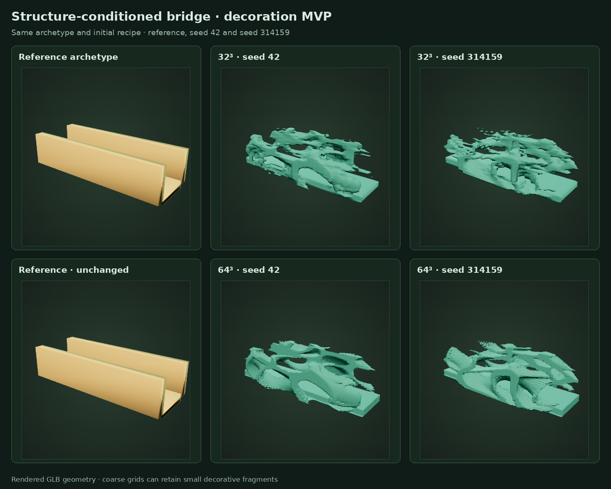

# Bridge decoration MVP review

This is review evidence for issue #13 items 1–4. The renderer shows one reference archetype and two generation seeds using the same initial recipe at 32³ and 64³. The source geometry and constraint sidecar remain shared across these examples.



| Geometry | Reference | Seed 42 | Seed 314159 |
|---|---|---|---|
| 32³ | [Reference](reference.png) | [Preview](bridge-32-seed-42.png) | [Preview](bridge-32-seed-314159.png) |
| 64³ | [Same reference](reference.png) | [Preview](bridge-64-seed-42.png) | [Preview](bridge-64-seed-314159.png) |

## Try it

```sh
go run ./cmd/progen serve
# Select Bridge / constrained decoration, generate, then compare reference/result/overlay.

go run ./cmd/progen generate --recipe examples/bridge.json --resolution 32 \
  --seed 42 --count 2 --search-seed 12
# Use a valid candidate ID returned by generation:
go run ./cmd/progen export --id CANDIDATE_ID --out bridge.zip
```

Fixtures: [coarse reference GLB](../../../examples/bridge.glb), [semantic sidecar](../../../examples/bridge.constraints.json), [normalized recipe](../../../examples/bridge.json). [Verification and limitations](validation.md) describes the exact local checks and the review fixes. Source ZIPs are generated on demand rather than duplicated in git.

These are exploratory decorative variations. Small disconnected pieces remain possible at 32³. The images support owner visual review; automated validity and connected-solid measurements do not establish visual novelty, gameplay readiness, or structural safety.
