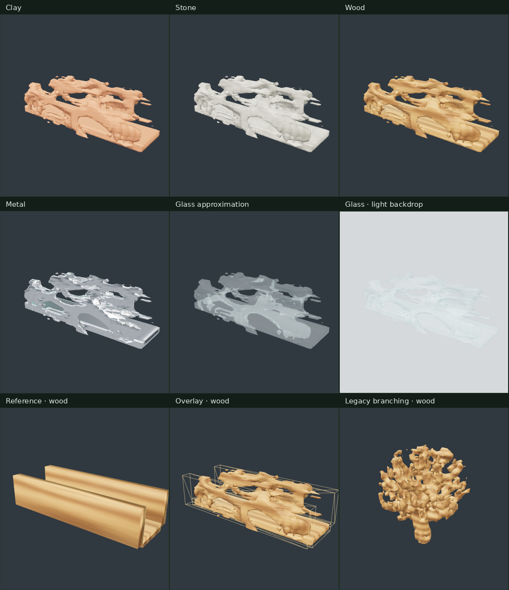

# Familiar material previews

Preview-only follow-up to PR #14, based on its merge commit
`2ad57d1354b87b6da720cf7bb314cd6ef1f06d77` on master. No stacked dependency remains.



## Try it

Run `go run ./cmd/progen serve`, select or generate a specimen, then change
**Material · viewer only** under the inspector. Clay is the default on every page
load. The selection persists while selecting candidates and importing archetypes
within the same page. Select slate, light or dark backgrounds to inspect edges and
transparency. Orbit/zoom work as before.

All meshes in the main viewer use the selected preset, including an imported
reference before generation. Reference and result use the same material and
coordinate scale. Overlay retains an amber wireframe reference for legibility.
Atlas thumbnails intentionally retain their original appearance.

| Preset | Roughness | Metalness | Technique |
| --- | --- | --- | --- |
| Clay | 0.88 | 0 | Warm diffuse dielectric, fine pores |
| Stone | 0.94 | 0 | 3D mottling, aggregate and pore surface detail |
| Wood | 0.62 | 0 | Longitudinal grain / radial rings and shallow relief, along canonical X |
| Metal | 0.23 | 1 | Neutral reflective metal |
| Glass approximation | 0.12 | 0 | Alpha 0.28, surface reflections, depth writes off |

The fixed Three.js RoomEnvironment is convolved with PMREM for reflections;
hemisphere/key/rim lights and ACES tone mapping are fixed. No HDR downloads,
texture assets or added dependencies are needed. Wood and stone are evaluated in
the canonical Y-up scene frame after mesh node transforms, normalized by the
recipe domain's longest axis. This is a seamless 3D solid texture, needs no UVs,
and remains aligned between reference and generated output at different mesh
resolutions. It does not infer planks or separate wood pieces. Fine wood rings
use screen derivatives to soften undersampled detail.

**Glass is simulated appearance, not physical transmission/refraction.** It has
no thickness, absorption, caustics or refracted background. Alpha blending may
show sorting artifacts at intersecting/overlapping surfaces. The label and
conditional help make this limitation explicit. Nothing here certifies real
materials or structural safety.

No geometry, stored vertex normals, recipe IDs, validation, server generation or exported
material data is modified. Preview materials replace/dispose viewer instances
only. Settings are deliberately not saved in recipes. Fixed formulas have no
random or time input; rendered pixels may vary between GPU/browser versions.

## Verification

- `npm ci`, `npm run build`, source and test syntax checks: passed.
- `go test ./...` and `go vet ./...`: passed (Go 1.26.0).
- `scripts/browser-implicit-test.mjs`: passed TPMS, Voronoi and hybrid workflows.
- Full `scripts/browser-bridge-test.mjs`: passed, including archetype import,
  comparison, 32³/64³, seeds 42/314159, validation and deterministic replay.
- `npm run test:materials`: passed in Chromium 140 / SwiftShader, no JS or GLSL
  errors. [Machine-readable assertions and image hashes](results.json).
- Material test uses `examples/bridge.json` and `examples/organic.json`, seed 42,
  resolution 32, one candidate each. It checks all five presets on bridge and
  legacy geometry; all comparison modes under each preset; exact rendered wood
  round trip; backdrop changes; camera orbit/zoom; mobile layout; reload default;
  no mutating API requests from material controls; unchanged provenance and
  constraint status; byte-identical candidate JSON, GLB and source ZIP entry contents.
- Screenshots are real browser captures. [Full studio](studio.png).

Reproduce after `npm ci`, `npm run build`, and `npx playwright install chromium`:

```sh
go build -o /tmp/progen-mvp ./cmd/progen
PROGEN_EVIDENCE_DIR=/tmp/progen-material-evidence npm run test:materials
```

Optional `CHROMIUM_PATH`, `PROGEN_BIN`, and `PROGEN_MATERIAL_TEST_PORT` select a
browser, binary and port. CI now runs this material test after its existing
implicit-family browser test. Visual acceptance remains for the owner; the
screenshots show conventional appearance experiments, not new geometry work.

## Deck surface detail

[Same-camera before/after deck renders and validation](surface-detail/README.md)
show the restrained clay/stone/wood lighting-normal and roughness detail. The
roughness values above remain the base values; these presets add spatial variation.
Metal, approximate glass, overlays and atlas thumbnails retain their existing
characters. `npm run test:material-detail` checks the procedural shader directly.
