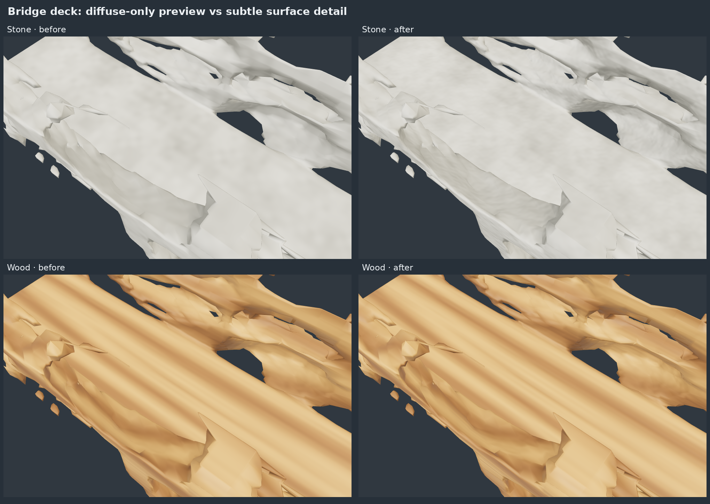

# Deck surface detail

Follow-up to the material previews at PR #15 head `93c4169`. The broad bridge deck looked unnaturally smooth beside the irregular sides. Clay and stone were already matte; the missing cue was fine variation in how light catches the surface.

Native 1000×640 captures: stone [before](before-stone-deck.png) / [after](after-stone-deck.png), wood [before](before-wood-deck.png) / [after](after-wood-deck.png). Both sides of each comparison use the same generated GLB, camera, canonical coordinates and studio lighting. The before shader is the unmodified source from `93c4169`. These are actual WebGL renders, not image-generated illustrations.

## Adjustment

- Stone: small aggregate/pore lighting-normal variation and local roughness variation.
- Wood: shallow relief following its existing rings and longitudinal grain, plus grain-dependent roughness.
- Clay: a lighter pore effect appropriate to its matte finish.
- Metal and approximate glass: existing shader/material behavior retained. In the comparison harness, their before/after renders are pixel-identical.

The procedural gradient perturbs only the fragment lighting normal. Vertex positions and stored normals are untouched. It uses the existing transformed canonical Y-up coordinates and domain scale, maintaining reference/result alignment and avoiding UV dependencies. There are no added textures or dependencies.

Analytic noise gradients avoid finite-difference resampling and derivatives of filter weights. Screen-space footprint filters smoothly remove fine normal, roughness and color detail under minification; wood's ring bands retain derivative filtering. No random/time input is introduced. Distinct program cache keys prevent stale preset shaders.

## Verification

Local final checks passed: frontend syntax/build, full `go test ./...` (62.686 s),
`go vet ./...`, the implicit-family smoke test, and both material browser tests.
[Machine-readable results and image hashes](verification.json) accompany the
actual rendered comparisons.

`npm run test:materials` covers all five materials on bridge and legacy geometry, reference/result/overlay, orbit/zoom, mobile layout, deterministic switching, no mutating API writes, byte-identical candidate JSON/GLB/export ZIP entry contents, unchanged constraints/provenance and unchanged atlas thumbnails.

`npm run test:material-detail` renders the real procedural shader on a flat canonical probe and a generated bridge. It verifies nonuniform lighting normals and roughness for clay/stone/wood; uniform controls for metal/glass; exact material-switch round trips; canonical alignment when equivalent plane geometry moves through mesh transforms; attenuation under minification; and unchanged silhouette coverage when a baseline is supplied. The harness also captures deck, orbit and grazing-light views. Browser/GLSL errors fail the test.

For local before/after comparison, set `PROGEN_MATERIAL_BASELINE` to the original `web/material-preview.js` file and `PROGEN_EVIDENCE_DIR` to an output directory. CI runs the focused test without a baseline checkout. Diagnostic pixel variation is a test signal, not a physical roughness measurement.

The effect is intentionally restrained. It adds shading cues, not relief geometry, new planks, collision detail or generator constraints. It does not address the separately reported degenerate-triangle diagnostic. Glass remains an alpha/reflection approximation. GPU/browser versions can differ in exact pixels; no device frame-rate or owner visual-acceptance claim is made.

ZIP container entry order is not stable in the existing exporter. The material
test compares every uncompressed entry byte-for-byte, independently of order;
this follow-up does not change export code.
