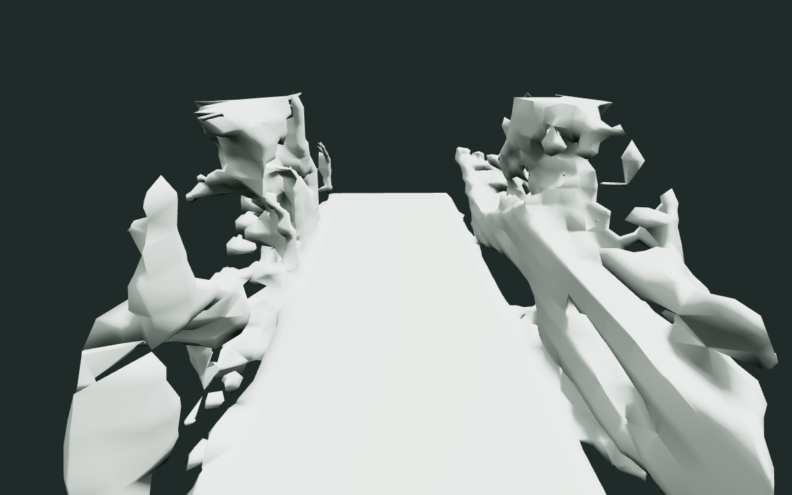
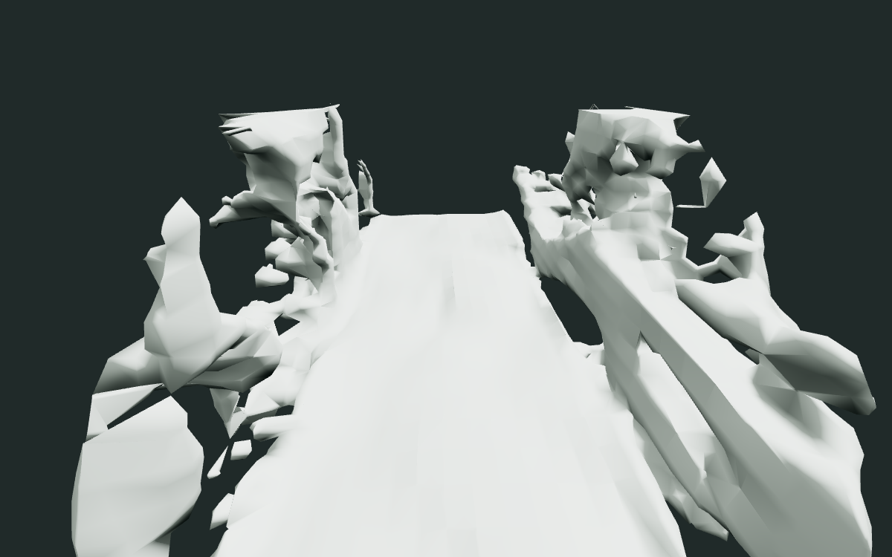
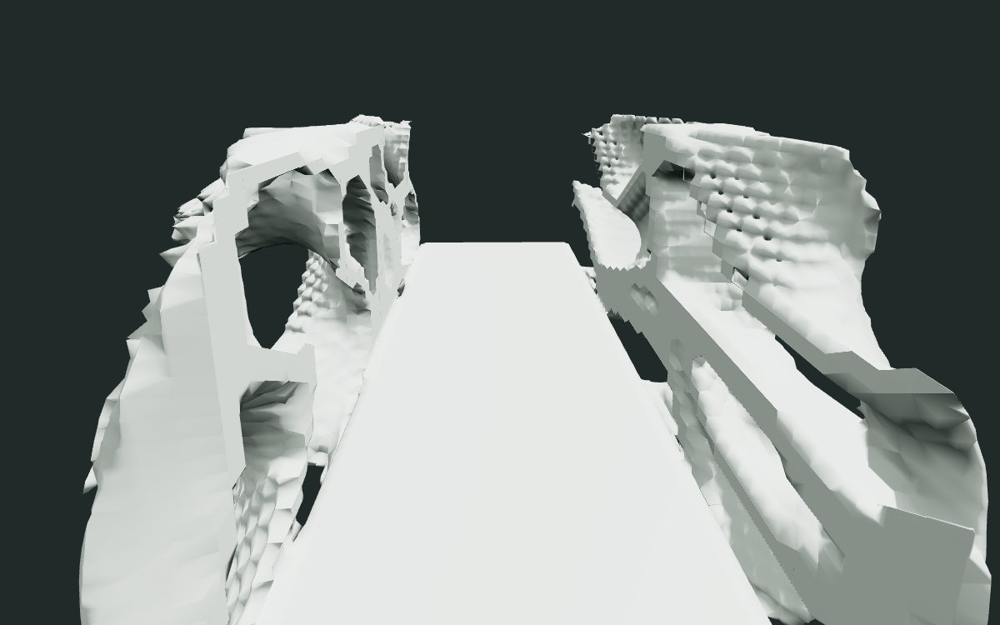
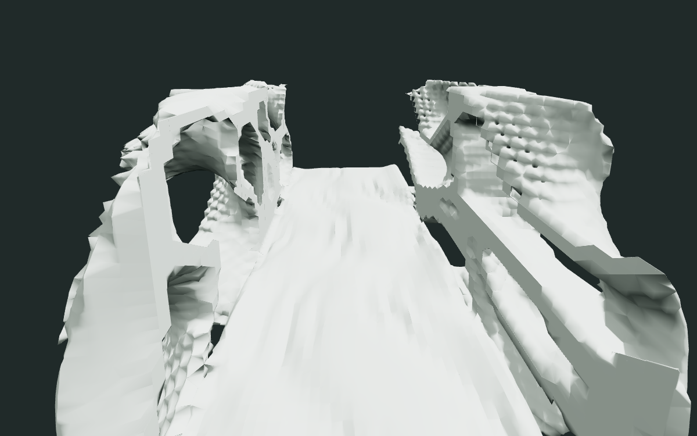

# Constrained floor relief experiment

Choose **Bridge / floor relief (experimental)**, then set **Floor relief
strength** (0–1) and **Floor depth** (0–0.06 meters). Either zero disables the
deformation. The original Bridge preset remains available and unchanged.

This is exported geometry, not a material effect. The floor samples the same
seeded, warped TPMS/Voronoi union that produces the walls. A fixed 0.18 m
horizontal filter and bounded height interpretation turn that field into broad
ridges and recesses. The center walking strip has a requested depth budget of
6 cm, with stronger raised contours toward the shoulders. Recesses are capped
at 6 cm to protect the built-in core. Actual heights depend on grid interpolation.

The operator deforms the scalar volume before canonical meshing. It does not
move final vertices. Changes fade at the ends, shoulders, and upper vertical
boundary; samples at or below -0.16 m remain exactly unchanged, preserving the
slab underside. A broad source-authorized region (-0.32 to +0.24 m vertically)
avoids relying on a thin editable skin with no samples at 32³.

## Contract and identity

The opt-in source sidecar is `examples/bridge-relief.constraints.json`.
Its explicit `floor_relief.region` permits floor deformation separately from
porous wall replacement. This expands the permitted floor region openly; it
does not change required solid, anchors, forbidden boxes, traversal width,
headroom, height tolerance, or the upward-normal predicate.

Every relief candidate must also have a closed, consistently oriented manifold
mesh with a single cyclic neighborhood at each vertex. Existing float32
precision repair, canonical regeneration, protected-surface, traversal, and
export checks remain in effect. Invalid candidates remain invalid.

New sidecar bytes, the new `floor_relief@1` node, its parameters and upstream
field identity participate in normal recipe/cache/provenance hashing. Original
source bytes are retained. Off produces the original volume and mesh exactly
for the same wall parameters, seed and resolution, although recipe/candidate
identities differ. Older readers reject the new optional sidecar field instead
of silently ignoring its authorization. No generation dependency was added.

This experiment supports centered, horizontal X-axis bridges with the existing
1.2 m traversal width and 0.1 m surface tolerance. It is not a generic terrain,
navigation or structural-safety system. Other wall parameters can still fail
admission. At a distant gallery camera the change is modest; the corridor views
below make the shallow structural relief easier to assess.

## Same-camera exported geometry

These are actual GLB renders, with identical camera, lighting and materials
within each comparison, using seed `14644082841431334434` and the original
diagnostic's wall parameters. No floor shader noise or displacement is used.

| Resolution | Flat, strength 0 | Relief, strength 1 / depth 0.06 m |
| --- | --- | --- |
| 32³ |  |  |
| 64³ |  |  |

32³ resolves broad, softer contours; 64³ resolves more ridges. Both keep a
continuous floor. In the three-seed test sweep, vertices of upward-facing
triangles intersecting the walking strip ranged from approximately -5.1 cm to
+7.8 cm (the latter includes shoulder vertices outside the strip). The minimum
upward unit-normal component was 0.7128, above the unchanged 0.7 predicate.
These measurements characterize the tested assets, not every possible recipe.

## Reproduce and verify

`TestFloorReliefExperiment` covers 32³ and 64³, seeds 42, 314159 and
14644082841431334434, exact legacy off equivalence, cached replay, actual GLB
coordinates, canonical matching, complete constraints, manifold topology and
walking-strip heights/slopes. Further fixtures cover intermediate controls,
depth/strength extrema, unchanged lower/outside samples, input immutability,
shared-field dependence, invalid controls, cancellation and source identity.

```sh
go test ./...
go vet ./...
npm ci
npm run build
go build -o /tmp/progen-mvp ./cmd/progen
CHROMIUM_PATH=/usr/bin/chromium npm run test:floor
node scripts/render-floor-evidence.mjs <workspace printed by test:floor>
```

The browser test exercises actual controls at both resolutions, validates six
exports, and verifies that depth zero and strength zero have identical exported
mesh payloads. The rendering script uses the exported files and a fixed camera.
