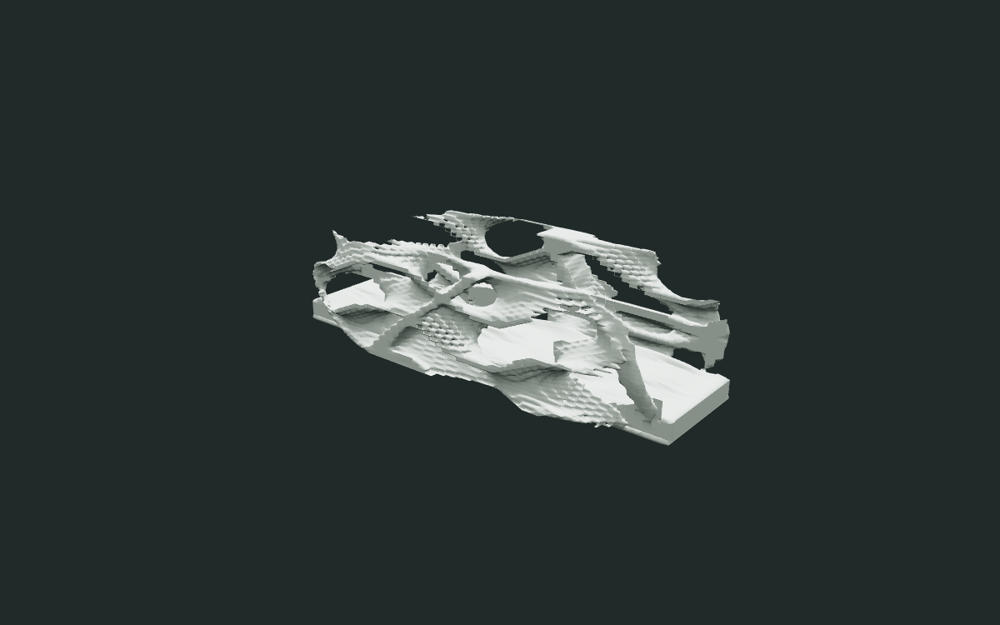
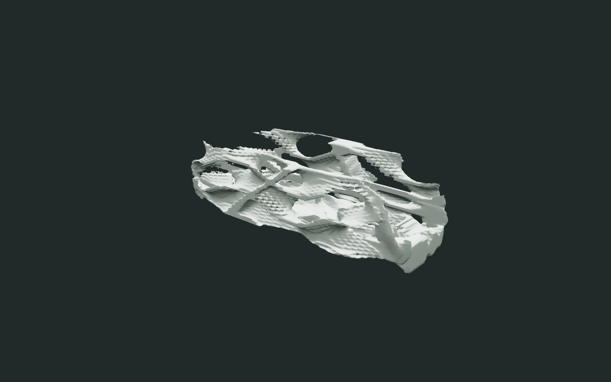
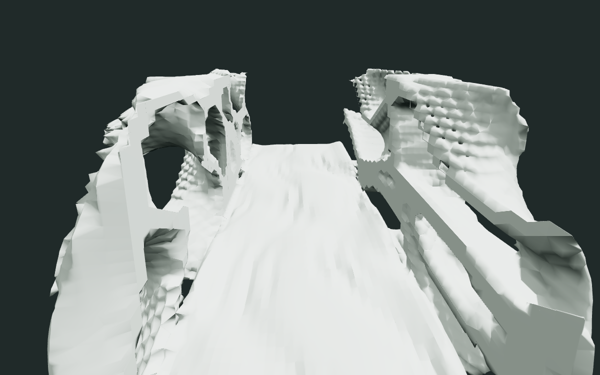
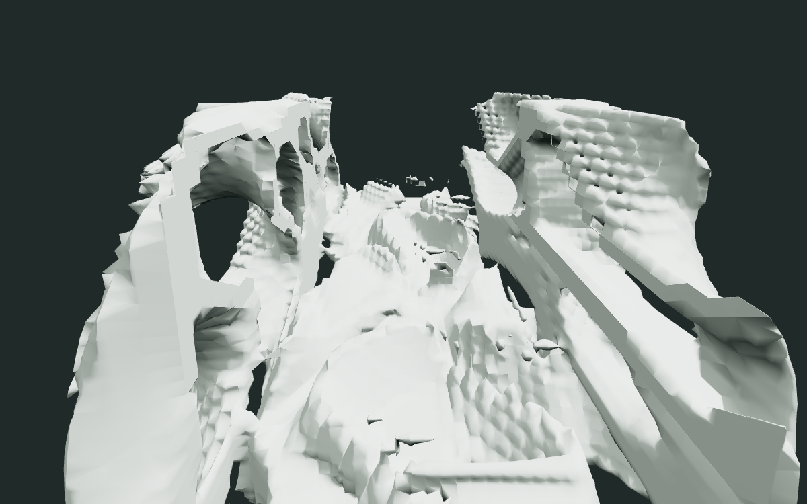
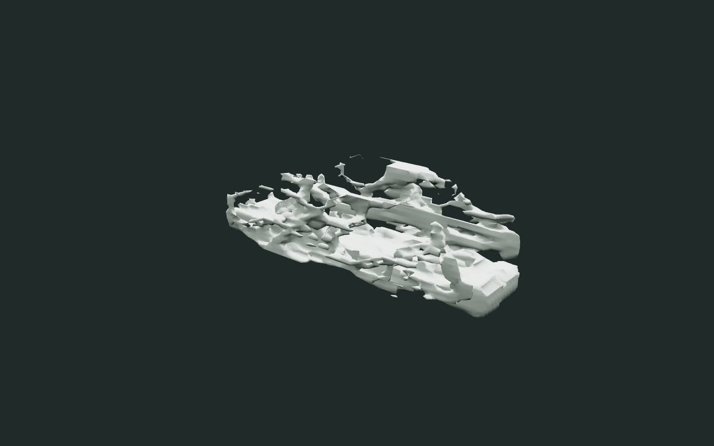
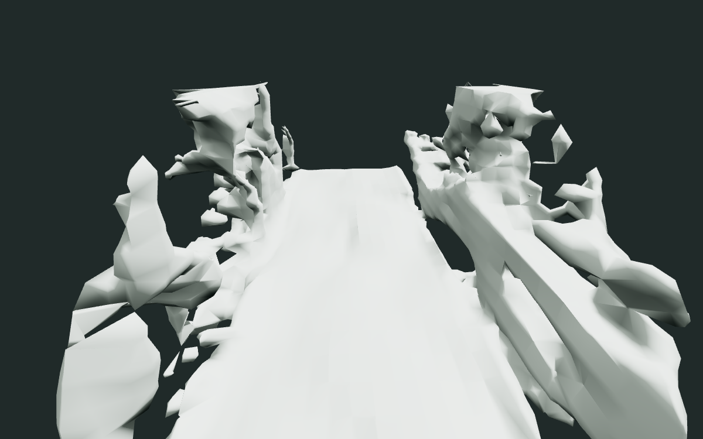
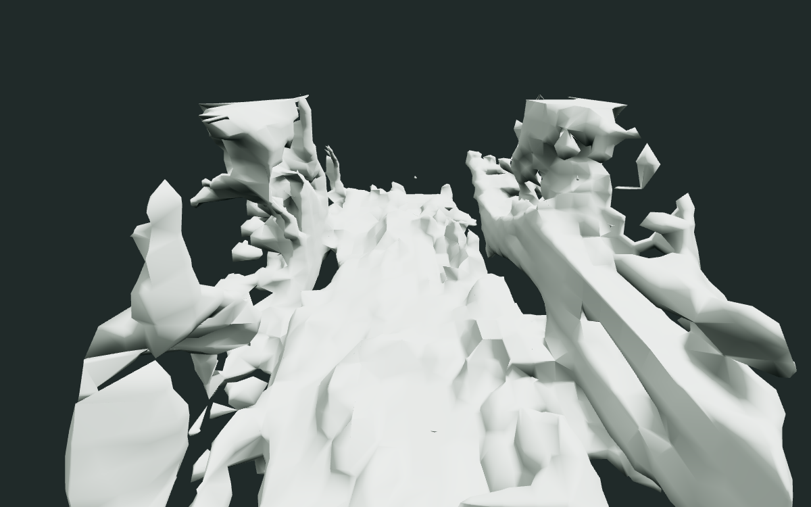

# Less-protected structural floor experiment

Choose **Bridge / structural floor (less protected)** to apply the shared warped
TPMS/Voronoi solid/void field directly to the deck. This is a separate source
contract and preset, alongside the unchanged original Bridge and conservative
Floor relief presets. It is exploratory morphology, **not a game-ready floor**.

Unlike the conservative heightfield, this changes deck edges, thickness, holes
and wall-floor transitions. A varying envelope bounds the deck; the same field
continues into the wall feet. No final-mesh displacement or material effect is
used. **Structural floor density** (0–0.18, default 0.09) biases the field toward
more solid material. **Structural floor contour** (0–1, default 1) controls
envelope variation. Both participate in batch mutation. Zero does not select
the conservative algorithm; switch presets for that comparison.

## Explicit contract change

The separate fingerprinted `bridge-structural.constraints.json`:

- replaces the broad protected deck core with a 0.36 m wide internal spine
  between X = -3.6 and +3.6 m, Y = -0.33 to -0.12 m;
- retains the original two endpoint anchor regions;
- expands editable material through the deck, from Y = -0.75 to +0.55 m;
- retains a smaller upper clearance box, starting at +0.65 m with 0.7 m width;
- declares `deck_policy: "structural-experiment"`.

A one-grid-cell guard around the reduced supports prevents interpolated mesh
corners from cutting their declared interiors. This is resolution-aware and
leaves a narrow regular spine and endpoint attachments, not a full rectangular
plinth. Their exact shape may remain visible.

Hard admission still requires finite, nondegenerate float32 geometry, canonical
volume/mesh identity, closed and consistently oriented manifold topology,
required solid/anchor preservation, the declared upper clearance, and endpoint
connectivity through face-adjacent negative volume samples. Float32 precision
repair is unchanged. Decorative disconnected components may remain; connected
endpoints do not imply every decorative piece belongs to one component.

The **original walking-strip checks still run**, but only as diagnostics for
this explicit policy. Candidate JSON, GLB provenance, gallery and selected-view
UI distinguish them from hard validity. `valid: true` means the chosen source's
hard contract passed, not that the original walking contract passed. The
`walking_checks` object reports whether checks were evaluated, whether they
passed, and each failure. Unknown policies are rejected. Original strict
sources still reject walking failures.

All six default structural specimens in the three-seed 32³/64³ sweep failed
the original support, upward-surface, sampled-headroom and mesh-headroom checks.
Those failures are deliberately visible. Holes, steps, protrusions and rough
surfaces are expected; these assets need further design before gameplay use.

## Same-seed geometry comparison

Actual exported GLBs, fixed camera and lighting, unchanged materials. Both
variants use seed `14644082841431334434` and its diagnostic wall parameters.
Conservative uses maximum relief (strength 1, depth 0.06 m); structural uses
density 0.09 and contour 1.

| View | Conservative | Less protected |
| --- | --- | --- |
| 64³ gallery |  |  |
| 64³ deck |  |  |
| 32³ gallery |  |  |
| 32³ deck |  |  |

The structural views show broken edges, large recesses/openings, varying
thickness and rough wall-like formations. The 32³ mesh is coarser. This is a
visual checkpoint for comparison, not a claim of universal aesthetic success.

## Verification and reproduction

The structural tests exercise seeds 42, 314159 and 14644082841431334434 at both
resolutions, deterministic cached replay, connected endpoints, actual export
identity/manifold checks, rejection by the old strict contract, rejection of
broken meshes under the new policy, control extremes, batch mutation and
cancellation. Existing strict and conservative regression suites remain intact.

`npm run test:floor` now exercises both variants, restores the strict preset,
checks visible policy wording and GLB diagnostics, validates nine GLBs, and
cancels a structural batch. It remains a hosted CI gate.

```sh
go test ./...
go vet ./...
PROGEN_STRUCTURAL_EVIDENCE=/tmp/structural go test -run TestStructuralDeckExperiment -v
CHROMIUM_PATH=/usr/bin/chromium npm run test:floor
```

For extended fixed-camera renders, put `structural-<resolution>-<seed>.glb`
and `conservative-<resolution>-<seed>.glb` in one directory for resolutions
32/64 and the three seeds above, then run:

```sh
node scripts/render-floor-evidence.mjs <directory> --structural
```

Source fingerprints, the new operator version/parameters, upstream field and
engine build participate in normal recipe/cache identities. No existing
source bytes or conservative semantics are overwritten. Asset generation
remains math-only with no new dependency.
